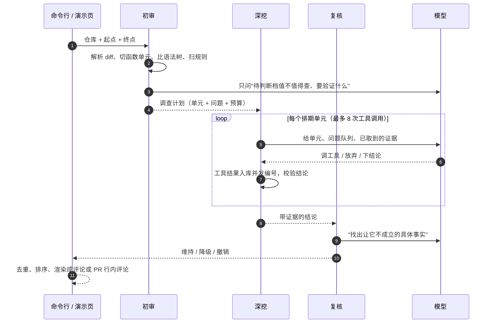

<div align="center">
  <h2>diff-review-agent</h2>

  <p>
    
    
    
    
    
    <a href="./LICENSE"></a>
  </p>
</div>

<div align="center">

一个用 Java 写的 <strong>代码审查智能体</strong>：读 git diff，判断哪些改动值得深查，调只读工具取证，只输出能被证据支持的评论。

</div>

## 项目预览

一次真实运行（语料里的 `null-guard-removed`，`deepseek-chat`，全流程，5.9 秒）：

```text
src/main/java/com/example/OrderService.java:18  [一致性]  断言

`find` 删除了 `order == null` 的守卫，第 18 行直接调用 `order.getName()`，
传入 null 时会抛 NullPointerException；同文件 `validate` 仍保留空判并抛
IllegalArgumentException，行为不一致。请恢复空判（返回 null 或按
`validate` 抛 IllegalArgumentException），并补一条 order 为 null 的测试。

证据：ev-1 OrderService.java:14-16   ev-2 OrderService.java:26-30
```

这次只读了这两个方法，没有读整个仓库。编号由程序分配，行号校验过、落在证据范围内，反引号里的符号也出现在证据原文中；这三项不过，评论不会输出。

## 功能

### 1. 初审：切改动、找结构变化、分档

- 输入是仓库路径和两个提交，JGit 取出改动的文件、新旧行号区间、重命名和删除。
- 改动按行号归到最内层的方法（函数外的改动归到字段、初始化块或类头），前后两版配对成分析单元。签名变了但方法名没变的，按名字重新配回同一个单元。
- 前后两版用 JavaParser 解析成语法树。声明部分直接比签名、可见性、`throws`、注解；方法体先按语句序列对齐，再识别固定形状：判空消失、条件翻转、捕获后只打日志、资源未关闭、提前返回丢失、运算符变化、字面量变化、新增 null 实参、纯语句换序。
- 静态检查单独跑一遍，只保留落在新增行上的告警：用 `==` 比字符串、捕获 `Throwable`、打印堆栈、生产代码里的 `System.out`。
- 分三档：命中必查规则的直接查，模型不能否决；四行以内且没有任何已知形状的跳过；其余交给模型判断值不值得查。
- 输出一份调查计划，每个单元带档位、风险类别、结构变化、命中规则和待验证的问题。

### 2. 深挖：调工具取证，结论必须引用证据

- 只处理排期单元，每个单元最多 8 次工具调用、12 轮。
- 七个只读工具：按行区间读文件、找声明、找引用、找调用点、判断对外可见性、全文搜索、查某几行的最近改动。
- 工具返回全部进证据库，编号 `ev-N` 在入库时统一分配，工具自己编不了号。
- 模型每轮只能做三件事：调工具、放弃并写理由、给出结论。结论要带证据编号和行号，并说明作者是该修（fix）还是该确认（confirm）。
- 结论过五条检查：陈述非空、必须引用编号、编号必须存在、结论所在行必须被证据或改动覆盖、反引号里的符号必须出现在证据或 diff 里。不过就丢弃并计数。

### 3. 复核：找反证

- 只复核必查和高风险类别，复核者有独立的 4 次工具预算和一个新的证据库。
- 撤销或降级必须引用它本轮真正读到的证据，引用不上就判无效、维持原结论。
- 结果三选一：维持成断言、降级成疑问句、撤销。

### 4. 输出与成本

- 同一位置的重复评论合并，按风险类别排序，输出 Markdown、JSON 或 GitHub PR 行内评论。
- 三档深度可切换：只做初审、加深挖、加复核。
- 每次运行统计模型调用次数和输入输出词元；提示词里只保留最近几条证据原文，更早的压成编号加位置。
- 被跳过的单元可以按比例抽样照样深挖，用来估计放过了多少有问题的改动。

## 系统流程



## 评估

语料是变异体：在五个文件上累积注入 47 个改动，31 个有明确缺陷，16 个是等价重构或纯格式改动，每个都有标准答案。评估把每个用例提交进一个真实 git 仓库，再用完整流水线重放。

真模型（`deepseek-chat`，温度 0）最近一次 47 条：

| 指标 | 数值 |
| --- | --- |
| 初审单元级召回 | 77%（24/31） |
| 干净改动的误报率 | 6%（1/16） |
| 结论总数 | 25 |
| 维持 / 降级 / 撤销 | 14 / 16 / 0 |
| 端到端召回（落点附近即有评论） | 74% |
| 端到端召回（评论引用了证据） | 65% |

语料从 22 条扩到 47 条，召回从 88% 掉到 77%。新增的用例里有人类一看就知道、但没有任何形状信号的行为变化（操作数互换、乘数改大），模型在待判断档上也会拒掉一些。语料变大让数字变差，这是它该走的方向。

三档深度各跑一遍同一份语料（22 条那一版）：

| 深度 | 抓到缺陷 | 标记干净改动 | 评论数 | 结论数 | 模型调用 | 词元 |
|---|---|---|---|---|---|---|
| 只做初审 | 13/16（81%） | 1/6（17%） | 21 | 0 | 39 | 17,290 |
| 加深挖 | 13/16（81%） | 1/6（17%） | 15 | 9 | 85 | 70,812 |
| 加复核 | 13/16（81%） | 1/6（17%） | 16 | 12 | 101 | 88,379 |

召回三行完全不动，因为召回是初审决定的：没被排期的单元，后面两段再强也救不回来。后两段买的是每条评论的可信度——21 条评论压到 16 条，覆盖的缺陷数没少。

把被跳过的单元按全深度抽查了一遍（七个被闸门放过的缺陷，一轮抓到五个）之后发现，闸门对"小"没判断错，错在把"小"读成了"安全"：漏掉的每一个都是真缺陷。补了字面量和 null 实参两类形状之后，离线重判这七个，六个会在问模型之前就进必查。代价是十六个干净用例里有四个被排期，其中两个待判断档模型自己会拒、一个故意升成必查的换序、一个日志文案误报（已修）。

数字怎么读：这些是单次运行的样本，不是对模型的测量。同一份代码重跑，端到端召回能差九个点。规则决定的那几行不受模型影响，当稳定部分看。

复现：

```bash
java -cp "target/classes;<classpath>" com.codereview.agent.eval.EvalRunner target/eval-corpus eval/run --real
```

报告写到 `eval/run/latest-report.md`；去掉 `--real` 用离线替身，不花钱也不需要密钥。


## 作者说的意图

PR 的标题和描述是作者自己写的意图。不接进来，整体扫描只能从文件清单、方法名、被删的代码去猜这次改动为了什么；接进来，就能拿真意图对照改动，比如描述说「只改了日志」而实际动了事务边界。

两条入口，都不需要协议：

```bash
# 从 GitHub 读一个 PR（可选 CODEREVIEW_GITHUB_TOKEN，测试用 CODEREVIEW_GITHUB_API 指向本地桩）
java -cp "target/classes;<classpath>" com.codereview.agent.review.ReviewPipeline <repo> <base> <head> out --pr owner/name#123

# 或从本地文件读，第一行是标题，其余是描述
java -cp "target/classes;<classpath>" com.codereview.agent.review.ReviewPipeline <repo> <base> <head> out --description note.txt
```

演示页上也有对应的一栏「作者说明」，填一行就会写进报告卡片。

这段文字进的是意图扫描的提示词，标明「作者自己的说法，不是证据」，并要求「改动和说明不一致就写进跨文件疑点」。它不进证据库，也不参与结论的证据校验——描述可以撒谎，证据编号不行。

检索层自己有度量：五条标记用例上，纯嵌入顶一命中 1/5，加词面加分 2/5，三条口令比较用例全部错到同一份文档里的兄弟条款。这张表在 `eval/latest-retrieval.md`。

**为什么不是 MCP。** MCP 解决的是跨进程、跨产品的工具发现与调用；这里只是读一个文档，加一层协议要多一个子进程、一套序列化、一类新的失败模式，换不到任何东西。写进简历的说法是：知道 MCP 与普通 HTTP 的边界，不为一个请求引入协议。

## 政策检索

仓库里可以放一份 `docs/policies/*.md`，写这个项目的硬性规定。初审把每个改动单元拿到这些条款里检索，命中的条款作为「规范摘录」贴进提示词，并且标了 `[强制]` 的条款直接把单元推进必查档——不问模型的意见。

做法上有几处是踩过才定下来的：

- **不装向量数据库。** 几百段文档，内存里暴力余弦就是微秒级；加一个库等于加一个服务、一份 schema、一种新的失败模式。这行字值得写进简历：评估过，判断不值得。
- **切块按标题。** 一个 `##` 一段，块编号带文件与标题（`pol-security-2`）。块号稳定，重跑时提示词里的引用不变。
- **查询不是整个 diff。** 把整个 diff 拿去嵌入会稀释成「Java 代码变了」。查询只写文件、方法名、结构变化，加上改动后的代码片段（截断）。
- **查询用中文。** 条款是中文写的，混语言查询会掉精度：同样三条用例，中文查询把正确条款的分数从 0.49 提到 0.61，无关改动停在 0.52，阈值 0.55 就能分开。
- **混合打分。** 纯嵌入会模糊标识符，`System.out`、`equalsIgnoreCase` 这种最强信号会被主题相似的无关条款压过去。加了一点按标识符重合的加分（权重 0.25）。
- **检索错的代价更大。** 摘录一律标注「这是规范摘录，不是代码证据」，且不参与结论的证据校验；正文校验仍然只认 `ev-` 编号。
- **不命中是正常状态。** 没有政策文档、嵌入端点没开、分数不过阈值，都只是「没有政策信号」，从来不算运行失败。

消融：同一份语料开关检索各跑一遍，召回与误报完全一样，只有两个单元从待判断档升到必查档（`resource-unclosed`、`policy-stdout-in-audit`）。原因写在 `eval/latest-policy.md`：我们写的强制条款恰好都能被路径或静态检查抓到，政策检索真正对付的是「无法用形状表达」的条款（令牌有效期、日志必带 trace id），这类只补了两条用例。

开关不是另一份代码：`--no-policy` 关掉的是同一条流水线的开关。

```bash
java -cp "target/classes;<classpath>" com.codereview.agent.eval.EvalRunner target/eval-corpus eval/policy-off --no-policy
```

## 技术栈

| 层次 | 技术 | 用途 |
| :--- | :--- | :--- |
| 接入 | JDK HttpServer、单页 HTML | 演示页：浏览提交、页内改文件并提交、切换深度、拉回被筛文件 |
| 编排 | Java 21 虚拟线程、自写状态机 | 单元级并发、工具预算、问题队列、阶段间结构化交接 |
| 取证 | JGit、JavaParser、JavaParser Symbol Solver | diff 与重命名、语法树比对、类型级调用图 |
| 模型 | LangChain4j 1.24、强制工具调用 | 四种回复全部走 JSON Schema 约束的工具调用；全项目只有一个类 import 该 SDK |
| 输出 | Jackson、GitHub REST | 计划与报告序列化、Pull Request 行内评论 |
| 评测 | JUnit 5、AssertJ、变异体语料 | 182 个测试，全程离线；评估与消融各自可复现 |

## 本地运行

### 环境要求

| 组件 | 要求 | 说明 |
| :--- | :--- | :--- |
| JDK | 21 | 虚拟线程与 `record` 都要用到 |
| Maven | 3.9 | 只用来构建；`mvn test` 不需要任何密钥 |
| 模型密钥 | 可选 | 只有 `--real` 需要，读环境变量 |
| Ollama | 可选 | 只有 `--ollama` 需要，本机自备模型 |
| GitHub 令牌 | 可选 | 只有真发 PR 评论需要 |

### 1. 跑测试

```bash
mvn test
```

182 个用例，全用离线确定性替身，不联网、不花钱。

### 2. 审一次真实提交

```bash
mvn -q compile
java -cp "target/classes;<classpath>" com.codereview.agent.Main <仓库> <起点> <终点> [输出文件]
```

输出是一份调查计划（JSON）。加 `--real` 才调模型，否则用离线替身。

### 3. 跑完整流水线

```bash
java -cp "target/classes;<classpath>" com.codereview.agent.review.ReviewPipeline <仓库> <起点> <终点>
```

写出 Markdown 与 JSON 两份报告，含每个单元的档位、结局、工具调用次数，以及通过复核的评论。

### 4. 打开演示页

```bash
java -cp "target/classes;<classpath>" com.codereview.agent.web.DemoServer
```

访问 `http://127.0.0.1:8099/`。左栏点两次就能选一个提交区间，右栏可以改一个文件、就地提交并立刻审这次提交。服务只绑回环地址，默认离线替身，点一次不花钱；`--real` 才走真模型。

### 5. 用真模型

```bash
export CODEREVIEW_LLM_API_KEY=...
# 可选：CODEREVIEW_LLM_BASE_URL（默认 https://api.deepseek.com/v1）
# 可选：CODEREVIEW_LLM_MODEL（默认 deepseek-chat）
```

密钥只从环境变量读，不落仓库、不进日志；模型描述里只打印"模型 at 地址"。

### 6. 用本地模型（Ollama）

```bash
ollama pull qwen2.5-coder:3b
OLLAMA_CONTEXT_LENGTH=8192 ollama serve
java -cp "target/classes;<classpath>" com.codereview.agent.web.DemoServer --ollama
```

默认连 `http://127.0.0.1:11434/v1`、模型是 `qwen2.5-coder:3b`，可用 `CODEREVIEW_OLLAMA_BASE_URL` 与 `CODEREVIEW_OLLAMA_MODEL` 改。本地生成慢，记住把超时调大：

```bash
export CODEREVIEW_LLM_TIMEOUT_SECONDS=600
```

Ollama 默认上下文是 4096，而本项目的提示词会带上整段证据，所以启动服务时按 8192 开，否则长单元会被截断。

实测数据来自一台只有 CPU 的机器：同一句话一次调用，3B 约 9 秒、7B 约 26 秒；审一个改动方法，3B 约 35 到 45 秒。7B 在这台机器上跑一个单元一小时没结束，所以默认模型是 3B，判断力换速度。

有一个必须知道的行为：Ollama 的 OpenAI 兼容接口接受工具定义，却不返回 `tool_calls`。本项目第一次碰到就把同一份 schema 改成文字要求并继续跑，日志里会留一行提示。3B 能走完整个循环——真的调工具、真的记录放弃理由——但它判断不准，经常读完就说没问题；这时管线不会编造结论，只会留下一条基于规则的问题，证据为空并注明未取证得出。模型弱，输出就弱，但不会假。

### 7. 回写 Pull Request

```bash
java -cp "target/classes;<classpath>" com.codereview.agent.publish.PostReview      <仓库> <起点> <终点> <owner/name> <pull number> [--post]
```

默认是预演：打印请求体并写到 `eval/latest-review-payload.json`。真发需要 `GITHUB_TOKEN` 和显式的 `--post`。落在 diff 之外的评论会被移进评论正文，而不是丢掉。

### 常见问题

| 现象 | 处理方式 |
| :--- | :--- |
| `UnsupportedClassVersionError: class file version 65.0` | 用了 JDK 17 启动，换成 JDK 21 |
| 控制台中文乱码 | Windows 控制台代码页问题，把输出写成文件再看 |
| `NoClassDefFoundError: CombinedTypeSolver` | `target/cp.txt` 是旧的，重新执行 `mvn dependency:build-classpath -Dmdep.outputFile=target/cp.txt` |
| 报 `CODEREVIEW_LLM_API_KEY is not set` | 没配密钥就用了 `--real`，去掉参数或先设环境变量 |
| 报 `This response_format type is unavailable now` | 该模型不支持 `json_schema`，本项目已改用强制工具调用，不该再出现；若出现说明用了旧版本代码 |
| 演示页提示没有评论 | 没有单元被排期，或结论都没通过证据校验；看单元表的「结局」列 |
| `--ollama` 连不上 | 没启动 `ollama serve`，或端口不是 11434；用 `CODEREVIEW_OLLAMA_BASE_URL` 指过去 |
| 本地模型答非所问、反复读同一处 | 上下文被截断或模型太小；按 8192 启动，先换 7B 试 |
| 本地模型很慢 | CPU 推理就是这个速度；演示时先挑一个单元的区间 |
| `git: 'credential-manager' is not a git command` | 这台机器没装 git 凭据管理器，命令行推不了仓库，改用 IDE 推送 |

## 目录结构

```text
diff-review-agent
├── src/main/java/com/codereview/agent/
│   ├── triage/          # 初审：diff 解析、单元映射、结构比对、规则、分档、计划
│   │   ├── structure/   # 语法树比对与形状识别（判空、运算符、字面量、换序……）
│   │   ├── rules/       # 规则目录与风险类别
│   │   └── staticanalysis/  # 第二路事实来源，只报新增行
│   ├── investigate/     # 深挖：证据库、七个只读工具、问题队列循环、结论校验
│   │   ├── tool/        # read_lines、find_definition、find_references、search、history
│   │   └── graph/       # 类型级调用图
│   ├── verify/          # 复核：对称取证、维持 / 降级 / 撤销
│   ├── review/          # 流水线、深度切换、抽样、报告与评论去重
│   ├── model/           # 薄接口 + LangChain4j 适配器 + Schema + 词元账本
│   ├── eval/            # 变异体语料、评估、消融、抽样扫描、调用图对照
│   ├── publish/         # GitHub 行内评论（默认预演）
│   └── web/             # 演示服务器（回环地址）
├── src/main/resources/web/index.html   # 演示页
└── eval/                # 每次运行的报告与数据
```

## 设计取舍

- **证据是校验出来的，不是请求出来的** — 别人靠提示词要求模型别编，这里靠程序：编号要能解析、行要在证据覆盖范围内、符号要在原文里出现，不过就丢。
- **单元就是函数** — 静态分析、测试覆盖、调用点本来就以方法为单位，选函数当单元，外部信号一次映射都不用做。
- **预算按单元数，不按词元** — 词元预算是花完才知道花在哪，还会把单个难单元饿死在半路；单元预算事前定得下、可复现、计划里解释得清。
- **阶段之间只传结论和发现，不传聊天记录** — 每段都能单独跑、单独打分、单独换模型，上下文也不会线性膨胀。
- **回答的形状是 schema，不是请求** — 四种回复全部走强制工具调用，字段由代码里的 JSON Schema 定死；DeepSeek 不支持 `json_schema`，`json_object` 又只管"是合法 JSON"，强制工具调用把两件事都约束住。
- **失败按块计，不按任务计** — 每个单元独立成败：正常出结论、因预算跳过、模型反复不合规被放弃，分别计数；一个单元翻车不连累整单，汇总如实报告"二十个查了十八个"。
- **模型层是薄接口** — 换模型等于加一个适配类；测试永远跑离线替身。
- **端点不支持强制工具调用时，schema 换成文字** — 同一个问题先按强制工具调用问，第一次被拒就整场改用文字描述 schema，并由原有的语法修复与机械校验兜住；本地模型就是这种端点。

## 已知限制

- **政策检索在我们语料上几乎没改变召回。** 见 `eval/latest-policy.md`：强制条款大多能被别的规则抓到，真正无法用形状表达的条款只补了两条用例。机制是通的，价值还没被这份语料证明。

- **语义类缺陷基本靠运气** — SQL 拼接、语句换序、边界魔法数这类改动，形状规则能覆盖一部分（换序、字面量、运算符），真正的业务语义（"这个校验应该在前"）程序判不了；位置敏感（认证、支付、迁移）的还能靠路径规则推进去，藏在普通业务逻辑里的会漏。
- **太胖的方法不切** — 单元就是方法，一千行的方法会让提示词过长、结论发散；按语句块再切需要重新映射所有外部信号，暂时没做。
- **被筛文件只能在前端拉回** — `Screening` 的决定如实记录并展示，命令行没有 `--include` 开关。
- **复核在这份语料上没赚回成本** — 它会降级、但从未撤销，因为合成缺陷大多是真的，确实没有反证可拿；`changedByCritic` 一直打印，就是为了让这件事不被"以为它在工作"掩盖。
- **评估语料是合成变异体** — 有标准答案，也因此偏向"能被形状发现"的缺陷；真实提交没有标准答案，要人工标注，两个标注者的 kappa 还没做。
- **单次运行只是样本** — 同一份代码重跑，端到端召回差九个点；文档里给了宽度也给了这句话。
- **不跑测试** — 只读边界、要编译目标仓库、偶发失败会污染证据，三条加起来的代价大于收益；真要做，`run_test` 是下一个工具。
- **本地小模型判断不准** — 3B 级的本地模型能把循环走完、会调工具、会给放弃理由，但它常常读完就说没问题；这时输出会退化成一条基于规则、没有证据的问题，而不是一条编造的结论。真模型上的数字不能拿它当对照。
- **GitHub 回写只做了评论，没做状态检查与自动修** — 也刻意没接"自动改代码"，那是另一个产品。

## License

本项目基于 [MIT License](LICENSE) 开源。
